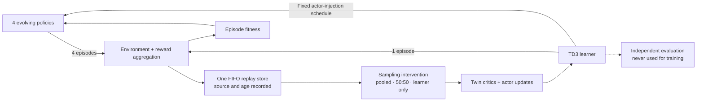
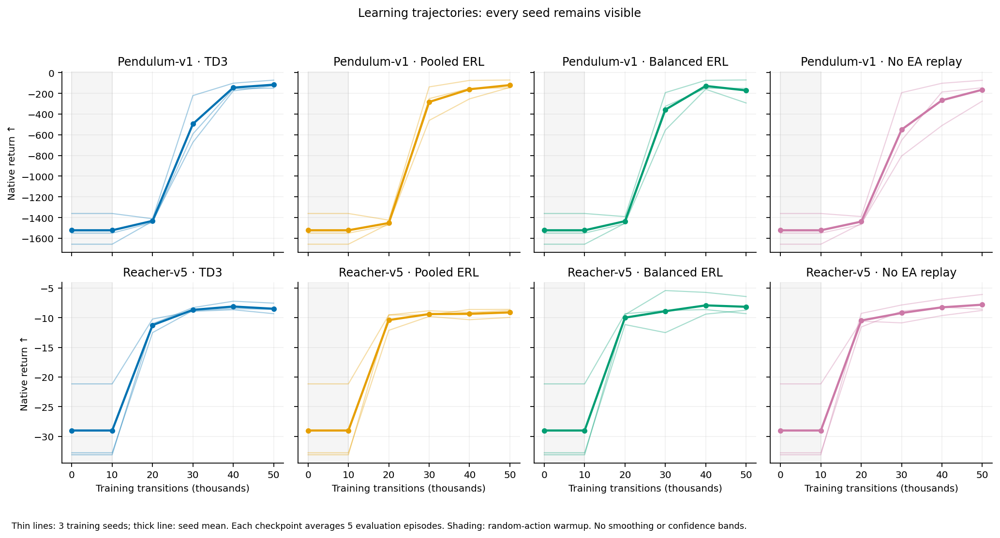
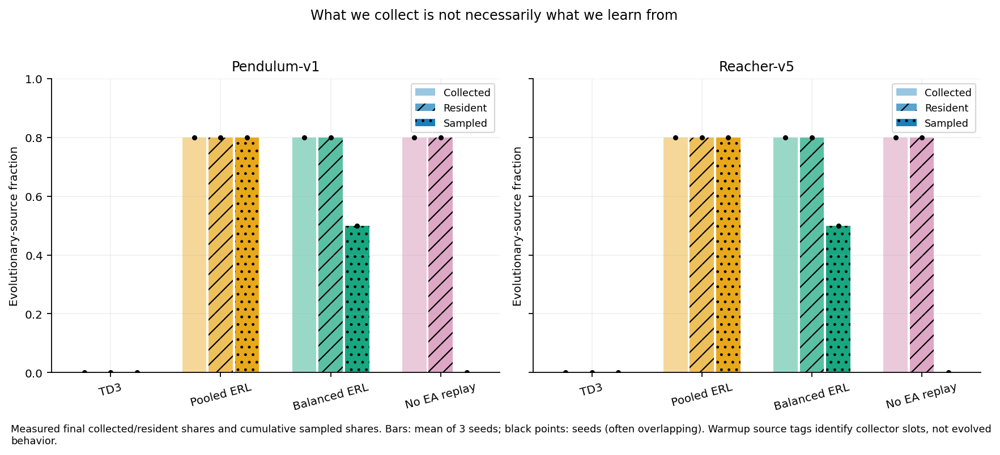

# When Does Evolutionary Experience Help?
### A controlled study of replay composition under delayed reward feedback

**CPU pilot completed 12 October 2026 · Next-stage implementation validated · Confirmatory execution pending**

Follow the [research progress log](docs/progress.md) for published milestones, the current stage, and its next checks.

The complete pilot's trained checkpoints and console logs are available in the [versioned `pilot-v1` release](https://github.com/ReloadLightly/evolving-reinforcement-learning-agent/releases/tag/pilot-v1), with SHA-256 checksums and restore instructions. The [first-stage protocol](docs/first-stage-protocol.md) specifies the next bounded experiment. Its implementation has passed **55 tests and eight short development runs**; the [validation report](results/validation/next-stage/report.md) and [next-stage learning guide](docs/next-stage-guide.md) explain those checks. The 40-run confirmatory experiment has not started.

> **Status:** all 24 CPU pilot runs completed with zero failures and passed artifact checks. Every learner improved from initialization. The pilot uses immediate rewards and three training seeds per condition; the delayed-reward hypotheses remain untested. This README reports measured pilot results alongside the prospective confirmatory protocol.

**Learn alongside the agent:** inspect the [pilot results](results/pilot/report.md) and [each run explained](results/pilot/run-guide.md), open the [interactive results explorer](results/pilot/explorer.html), or start with the [learning guide](docs/learning-guide.md), explore the math in the [interactive learning lab](docs/learning-lab.html), follow the [lab notebook](docs/lab-notebook.md), and inspect each run's `journal.md` under `results/pilot/`. Open the HTML file locally in a browser; it needs no server or network connection. Every checkpoint separates **OBSERVE → EXPLAIN → CHECK → NEXT** so measured facts, their interpretation, and the next action remain distinct.

## Abstract

Evolutionary reinforcement learning (ERL) couples population-based policy search with gradient-based learning. Population trajectories can broaden the learner's experience, but indiscriminate replay can also overwhelm its own data. Recent methods address this tension through experience filtering, multiple buffers, and adaptive transfer. We propose a controlled investigation: **does sampling equal proportions of evolutionary and learner experience improve the learner's sample efficiency under delayed reward feedback compared with uniform pooled replay?** We will study an ERL-style TD3 learner on Pendulum and Reacher, holding population size, mutation, actor injection, collected interactions, and gradient updates fixed across replay interventions. Dense feedback provides a reference condition; learner-only replay and standalone TD3 separate the mechanism comparison from practical performance. The primary outcome is normalized evaluation-return area under the learning curve. Independent training seeds, prespecified contrasts, and uncertainty intervals will support a bounded conclusion about these tasks. The intended contribution is an interpretable experiment and reproducible analysis, not a new state-of-the-art algorithm. A completed 24-run immediate-reward pilot used 1.2 million training transitions and found improvement from initialization in every run. Balanced-versus-pooled AUC differences had opposite signs across tasks. These descriptive results establish pilot learnability and feasibility; they do not test the delayed-reward hypotheses.

## 1. Introduction

Evolution and reinforcement learning improve policies in different ways. Evolution evaluates complete behaviors, selects successful policies, and generates variants. An off-policy RL learner reuses individual transitions to update a critic and improve an actor. ERL connects them through two channels: population experience enters replay, and the trained actor periodically enters the population. The original ERL paper introduced this feedback loop and already investigated delayed rewards. [Khadka and Tumer, 2018](https://arxiv.org/abs/1805.07917)

More evolutionary experience does not necessarily mean more useful experience. In a population of four policies collecting one episode each for every learner episode, approximately 80% of a shared buffer comes from the population. Uniform replay therefore gives the learner relatively little access to its own behavior. Changing this ratio is simple enough to study without changing the entire algorithm.

This project asks whether that allocation matters when reward feedback becomes less frequent. It is designed to teach policy evolution, off-policy learning, experimental controls, and statistical inference through one coherent question.

## 2. Related work and research position

| Direction | Established contribution | Consequence for this study |
|---|---|---|
| [ERL, 2018](https://arxiv.org/abs/1805.07917) | Population replay and periodic actor injection; delayed-reward experiments. | Neither hybridization nor delayed-reward robustness is new. |
| [CEM-RL, 2019](https://arxiv.org/abs/1810.01222) | Combines evolutionary distribution search with gradient updates and analyzes component choices. | Changing the optimizer would obscure our replay comparison. |
| [ES-TD3Buffers, 2023](https://arxiv.org/abs/2306.11535) | Separates experience into buffers to control population trajectories' influence. | Multiple buffers and selective sampling are prior art. |
| [EvoRainbow, 2024](https://proceedings.mlr.press/v235/li24cp.html) | Examines and combines several ERL mechanisms. | A broad “best of evolution and RL” project would be poorly bounded. |
| [SERL-OS-EF, 2025](https://doi.org/10.1109/TNNLS.2025.3596553) | Operator selection, experience filtering, and dynamic mixed sampling. | Adaptive replay is already occupied territory. |
| [LCERL, 2026](https://ieeexplore.ieee.org/document/11223076) | Late-start evolution and an archive address experience quality and diversity. | Poor early population data is an existing explanation to investigate. |

The last two entries are supported by author abstracts or author-site descriptions; full-text access was limited. The [literature review](docs/literature-review.md) records access levels, additional 2023–2026 work, alternatives, and the search boundary.

**Proposed contribution.** A controlled replication and extension measuring replay composition × reward-feedback delay, with equal collection and update budgets and a distinction between the RL actor and the population. We did not locate this exact experiment in the inspected sources. That does not establish first-ever novelty.

We defer quality-diversity archives, learned reward functions, continual dynamics changes, and LLM-based evolution. Each adds another research question. CPU feasibility and interpretability take priority over benchmark breadth.

## 3. Research question and hypotheses

**Research question.** On Pendulum-v1 and Reacher-v5, under equal interaction and gradient-update budgets, does a 50:50 mixture of evolutionary and learner-generated replay improve the TD3 learner's sample efficiency under 20-step reward aggregation relative to uniform pooled replay?

Let $A_{e,s}(m,d)$ be normalized evaluation-return area under the learning curve for task $e$, training seed $s$, method $m$, and feedback interval $d$. Define

$$
\Delta_d =
\frac{1}{|E|\,|S|}
\sum_{e \in E}\sum_{s \in S}
\left[A_{e,s}(\mathrm{balanced},d)
-A_{e,s}(\mathrm{pooled},d)\right].
$$

**H1 — primary:** $\Delta_{20}>0$. Balanced replay improves sample efficiency under delayed feedback by retaining population experience while reducing its dominance.

**H2 — secondary:** $\Delta_{20}-\Delta_1>0$. The advantage is larger with delayed feedback than with immediate feedback.

**H3 — mechanism check:** under delayed feedback, balanced replay outperforms the same ERL system with population transitions excluded from minibatches. Failure here would weaken the argument that population experience itself is useful.

These are predictions, not assumed outcomes. A five-percentage-point difference on the normalized AUC scale is the proposed threshold for practical importance. A confidence interval crossing zero is inconclusive; a consistently negative contrast contradicts H1. A positive but small effect does not establish practical importance.

The first study estimates H1 and H2 on Pendulum alone. H3 and the practical TD3 comparison require the extension. The full study extends the fixed task set to Pendulum and Reacher, reusing the Pendulum runs; it is not an independent replication of the first study. The [protocol](docs/protocol.md) specifies decision rules and inference boundaries.

## 4. Methods

### 4.1 Tasks and feedback intervention

We propose [Pendulum-v1](https://gymnasium.farama.org/environments/classic_control/pendulum/) and [Reacher-v5](https://gymnasium.farama.org/environments/mujoco/reacher/): small continuous-control tasks suitable for a CPU study. Their configured episode limits are 200 and 50 steps. The second task provides a limited replication across dynamics and horizon, not evidence about large locomotion benchmarks.

At $d=1$, the learner receives the native reward each step. At $d=20$, rewards accumulate and are emitted every 20 steps; the remaining sum is flushed at **both termination and truncation**. All agents receive the same feedback treatment. Fitness uses complete episode returns. Evaluation reports the underlying undiscounted native return.

**Interpretation boundary:** aggregation preserves undiscounted episode totals, but changes the discounted TD3 objective and introduces reward-history dependence that a memoryless policy does not observe. This is a delayed/aggregated-feedback stress test, not an isolated manipulation of temporal credit assignment. Twenty steps also represents a different fraction of the two episode horizons.

### 4.2 Shared learning system

The backbone is a small ERL-style implementation using [TD3](https://proceedings.mlr.press/v80/fujimoto18a.html), four evolving actors, tournament selection, elitism, and Gaussian parameter mutation. It is an experimental variant, not a claimed faithful reproduction of original ERL.



*Figure 1. Proposed information flow. Only the replay sampler changes among the three ERL arms. This is a method diagram, not experimental evidence.*

| Arm | Population collection | Learner replay | Purpose |
|---|---|---|---|
| **ERL-balanced** | Four population episodes per learner episode | 50% population, 50% learner | Target intervention |
| **ERL-pooled** | Identical schedule | Uniform across shared store; approximately 80% population | Primary comparator |
| **ERL-no-EA-replay** | Identical evolution, collection, and injection | Learner transitions only; population data remains stored | Isolate population replay contribution |
| **TD3** | All interaction budget goes to learner | Uniform learner replay | Practical baseline at equal interaction/update budgets |

Replay membership and eviction use the same global FIFO rule in every ERL arm. Changing the sampler must not silently change capacity or retention. Actual source proportions and age distributions will be logged. Online trajectories will diverge as learning changes; matched schedules and seeds do not mean identical data.

Proposed settings are two 64-unit hidden layers, batch size 128, 200,000 training transitions per run, and 0.25 twin-critic update steps per collected transition after 10,000 warmup transitions. Actor updates occur every second critic update. Population fitness rollouts count toward the training budget. The [protocol](docs/protocol.md) defines mutation, injection, replay, reset, and TD3 settings.

### 4.3 CPU budget and staged execution

The first stage asks the central question on one task; subsequent work extends the same run set. **The full study includes the first stage, rather than repeating it.**

| Stage | Design | Runs | Training transitions | Evaluation transitions |
|---|---|---:|---:|---:|
| Pilot | Four arms × two tasks × immediate feedback × three separate seeds; 50k/run | 24 | 1.20M | 0.09M |
| First study | Balanced and pooled × Pendulum × two feedback conditions × ten seeds | 40 | 8.00M | 0.84M |
| Full study, cumulative | Four arms × two tasks × two feedback conditions × ten seeds | 160 | 32.00M | 2.10M |

Evaluation uses five episodes at each of 21 confirmatory checkpoints, including initialization. An independent 20-episode random-policy reference per task adds 5,000 interactions. Counts assume configured episode horizons; actual counters remain authoritative.

The completed pilot used 20.73 minutes across the profiling and main-sweep execution invocations on an Intel Core i5-1035G1 CPU. The two singly profiled runs were reused; the remaining 22 ran with at most two concurrent workers, each using one computational thread. Maximum measured process memory was 680.7 MiB. These invocation times exclude setup, calibration, analysis, and pauses between invocations. The 200,000-step confirmatory runtime has not been measured. If the full study is too expensive, the 40-run first study stands alone with a one-task conclusion. We will not inspect confirmatory outcomes and then reduce seed counts or choose a favorable task. Optional controls are separate from the initial commitment.

### 4.4 Evaluation and inference

The primary evaluated policy is always the **TD3 actor**, using deterministic actions and evaluation seeds separated from training. Population fitness is a diagnostic, not a substitute for held-out learner evaluation.

For each task, normalize return using a fixed, independently measured random-policy reference $R_e^{\mathrm{random}}$ and the native reward upper bound of zero:

$$
z_{e,s}(t)=
\frac{R_{e,s}(t)-R_e^{\mathrm{random}}}
{0-R_e^{\mathrm{random}}},
\qquad
A_{e,s}=\frac{1}{B}\int_0^B z_{e,s}(t)\,dt.
$$

Estimate the integral by the trapezoidal rule on the prespecified checkpoint grid. Do not clip scores; provide raw returns alongside normalized summaries. Interval calculations are conditional on the frozen normalization references.

Use ten independent training seeds per condition and 10,000 paired bootstrap resamples of whole seed trajectories within each fixed task. Checkpoints and evaluation episodes are not independent training replicates. Report per-task effects and the equal-weight suite estimate. H1 is the sole primary contrast; H2 and H3 are secondary. Ten seeds are a budget choice, not a guarantee of adequate power.

This approach follows the emphasis on uncertainty and experimental design in [Agarwal et al., 2021](https://arxiv.org/abs/2108.13264) and [Patterson et al., 2024](https://www.jmlr.org/papers/v25/23-0183.html). Full seed points, failed runs, and protocol deviations will remain visible.

## 5. Visualization and analysis plan

The completed pilot provides [nine figure families](results/pilot/report.md), each exported as PNG, SVG, and PDF, plus an [offline explorer](results/pilot/explorer.html). They cover learning curves, initial-to-final change, AUC, replay provenance, resident age/reuse, behavioral diversity, CPU/storage cost, and evolutionary lineage. All empirical panels use recorded measurements. The next-stage analyzer now implements ten figure families, including paired effects, the delay interaction, sampled-age heatmaps, replay-reuse quantiles, reward-phase critic residuals, and gradient alignment. These have passed temporary synthetic export checks; no confirmatory figure is populated with synthetic results. The table below preserves the broader study plan.

| Planned figure | Scientific question | Evidence and presentation |
|---|---|---|
| **Learning-curve small multiples** | Does replay composition change learning speed? | Task × delay panels, faint seed curves, mean and bootstrap intervals; unsmoothed primary data. |
| **Paired-effect estimation plots** | How large and consistent is the benefit? | Per-seed paired AUC differences, bootstrap distribution, zero and practical-effect lines. |
| **Interaction plot** | Does delay modify the replay effect? | Balanced-minus-pooled effects at both delays; interval on their difference. |
| **Replay source × age heatmaps** | What experience does the learner actually see? | Sampled counts by source, age bin, and training checkpoint; fixed bin definitions. |
| **Population fitness distributions** | Does learner progress accompany population progress? | Generation-wise quantiles and individual fitness, with learner evaluation shown separately. |
| **Behavioral diversity trajectories** | Does the population retain different behaviors? | Action disagreement on fixed independent probe states; descriptor spread as a secondary view. |
| **Source-conditioned learning diagnostics** | Do sources produce different learning signals? | TD-error distributions and critic-gradient cosine similarity at fixed checkpoints; not proof of critic accuracy. |
| **Evolutionary lineage graph** | Which lineages survive, including injected actors? | Parent IDs, mutations, injection markers, and survival duration; complete underlying records. |
| **Compute–performance frontier** | Is improvement useful on a CPU? | AUC/final return versus wall time and update counts; disclosed hardware and thread settings. |
| **Final-return distributions** | Does an average hide unreliable runs? | Every seed, empirical distributions, and intervals; no “best seed” headline. |
| **Replay dose-response** — optional | Is 50:50 near a useful operating region? | Additional 25% and 75% population replay on delayed tasks; no invented intermediate measurements. |
| **Matched rollout panels** — optional | What does the numerical difference look like? | Fixed initial states and prespecified median-seed selection; no cherry-picked successful videos. |

Static figures should export SVG and PDF with an accessible palette, labeled units, and captions defining uncertainty. A supplementary interactive HTML view may filter by seed and expose trajectories. Claims must remain assessable from the static figures and underlying data.

## 6. Results

### 6.1 Immediate-reward CPU pilot

**All 24 planned runs completed; none failed or were replaced.** Each task/method has three independent training seeds, each evaluated on five held-out starting conditions at six checkpoints. All 24 final learner returns exceeded their own initial return. The implementation passed [27 tests](results/verification/checks.json), and the complete dataset passed budget, evaluation-grid, seed-pairing, source-hash, and replay-mixture checks.

| Method | Pendulum final return | Pendulum raw AUC | Reacher final return | Reacher raw AUC |
|---|---:|---:|---:|---:|
| TD3 | -116.29 ± 40.00 | -882.83 | -8.50 ± 0.90 | -15.17 |
| ERL-pooled | -120.36 ± 42.51 | -848.16 | -9.11 ± 0.74 | -15.45 |
| ERL-balanced | -171.84 ± 112.49 | -858.17 | -8.17 ± 1.53 | -14.89 |
| ERL-no-EA-replay | -164.92 ± 101.84 | -924.58 | -7.81 ± 1.50 | -15.07 |

Final returns are mean ± **sample standard deviation across three training seeds**, not confidence intervals. Raw AUC is the trapezoidal learning-curve integral divided by 50,000 transitions, including initialization and warmup; it has native-return units. Higher, less negative values are better. Raw scales differ across tasks and should not be averaged together.



*Figure 2. Immediate-reward learning curves. Thin lines show every training seed; thick lines show the mean. Each point averages five evaluation episodes. Shading marks random-action warmup. No smoothing or confidence bands are used.*

Balanced minus pooled mean raw AUC was **−10.01 on Pendulum and +0.56 on Reacher**. Endpoint choice also changes descriptive rankings: TD3 had the highest mean final Pendulum return, while pooled ERL had the highest mean Pendulum AUC. On Reacher, no-EA replay had the highest mean final return, while balanced ERL had the highest mean AUC. These three-seed pilot observations do not establish a method advantage or answer H1.

### 6.2 Did the intended experiment happen?



*Figure 3. Replay provenance audit. The ERL arms all collected and retained 80% population-source transitions. Actual cumulative minibatch shares were approximately 80% for pooled replay, exactly 50% for balanced replay, and exactly 0% when EA replay was blocked. Warmup tags identify collector slots, not evolved behavior.*

The [reuse figure](results/pilot/figures/replay-reuse.svg) explains a consequence: balanced replay averaged 64 draws per stored learner transition and 16 per population transition by the end of a run. Pooled replay averaged approximately 25.6 per transition from either source. Changing replay composition therefore changes how intensely each source is reused, even though collection and storage budgets match.

Total measured work was **1,200,000 training transitions, 90,000 evaluation transitions, 240,000 twin-critic updates, and 120,000 actor updates**. Independent calibration added 5,000 interactions. The [lineage audit](results/pilot/lineage-audit.json) checked all 1,800 evolutionary generations and 144 scheduled learner injections against recorded parentage and fitness. It verifies recorded selection behavior, not a causal benefit from evolution.

The two execution invocations took **20.73 minutes** combined. Individual recorded run times ranged from 49.7 to 130.8 seconds; peak process memory was at most 680.7 MiB. Summed per-run wall time was 36.90 minutes because concurrent runs overlap. Profiling and concurrent runs experienced different contention, so these times cannot fairly rank methods by speed. See [hardware and software](results/pilot/software-environment.json), [execution records](results/pilot/pilot_execution.json), and the [full report](results/pilot/report.md).

### 6.3 Validation of the next-stage implementation

The expanded implementation passed **55 unit and integration tests**, including exact training-trajectory equivalence with diagnostics enabled, diagnostic checkpoint restoration, protocol-integrity checks, and paired-bootstrap mathematics. Eight additional development runs used seeds 10 and 11, both replay arms, and both delays. All eight completed with zero failures and passed their artifact checks. Each used 16,000 training transitions: 10,000 warmup transitions followed by 1,500 twin-critic and 750 actor updates.

These runs consumed **128,000 training and 28,800 evaluation transitions**, with 1.30 minutes recorded for the validation execution. That duration excludes the separately recorded unit-test run. Their short learning budget exercises implementation and logging; it does not establish delayed-reward learnability or test H1. Returns, including deterioration from initialization, remain visible in the [development report](results/validation/next-stage/report.md); [machine-readable validation evidence](results/validation/next-stage/checks.json) records exact counts and file hashes.

Their 72 actor snapshots, eight final checkpoints, and eight console logs are preserved in the [checksummed `next-stage-v1` release](https://github.com/ReloadLightly/evolving-reinforcement-learning-agent/releases/tag/next-stage-v1), together with the versioned implementation and frozen study plan.

The new diagnostics use independent replay samples and target-noise streams. They distinguish resident-buffer quantiles from bounded sampled-age estimates and compare source-conditioned critic residuals by reward-block phase. The [next-stage guide](docs/next-stage-guide.md) explains why these measurements help interpret learning without becoming evidence of its cause.

### 6.4 Confirmatory endpoints

| Endpoint | Status | Planned evidence |
|---|---|---|
| H1: balanced − pooled AUC under delayed feedback | Not run | Ten disjoint training seeds per condition; paired bootstrap interval |
| H2: change in that contrast with feedback delay | Not run | Matched immediate/delayed conditions |
| H3: balanced − no-EA-replay under delayed feedback | Not run | Full-study mechanism comparison |

The pilot does not supply p-values, confidence intervals, or a delayed-reward conclusion. Its source is preserved in [immutable snapshots](results/pilot/source/); its diagnostic simplifications and remaining confirmatory requirements are documented in the [protocol](docs/protocol.md).

## 7. Discussion and limitations

The pilot establishes that this compact implementation learns on both tasks within the CPU budget. Its mixed method rankings motivate keeping the original comparison and all its controls. The results do not justify choosing a favorable task, changing H1, or treating increased learner-data reuse as an established cause of improvement. The richer diagnostics and analysis are now implemented and validated. The next step is the separately initiated, frozen 40-run comparison; its outcome remains unknown.

A positive H1 result would support changing replay allocation in this particular system. It would not establish that evolutionary replay is necessary: H3 and standalone TD3 address different parts of that argument. If balanced replay beats pooled replay but loses to TD3, it repairs part of a hybrid without justifying the hybrid's cost.

If H1 is near zero with a narrow interval, replay balance may be unimportant at this scale. A wide interval means the study is inconclusive. If H1 is negative, reducing population exposure may discard useful exploration. Each outcome can support a worthwhile learning project and an honest paper.

Limitations include two small tasks, one RL backbone, a small population, fixed hyperparameters, approximate uncertainty with ten seeds, and the feedback intervention's non-Markov and discounting effects. Diagnostic correlations cannot establish that diversity causes improvement. Contemporary algorithms such as EvoRainbow and SERL-OS-EF are research context, not reproduced performance baselines. Conclusions must not extend to state-of-the-art rankings, sparse-goal discovery, high-dimensional locomotion, or real robots.

## 8. Reproducibility and implementation sequence

Research and implementation artifacts:

- [Literature review](docs/literature-review.md): evidence, prior work, access limitations, and candidate selection.
- [Experimental protocol](docs/protocol.md): algorithm, controls, statistics, logging, and implementation acceptance criteria.
- [Study configuration](configs/study.json): machine-readable proposed run design.
- [Study planner](scripts/study_plan.py): dependency-free budget summary and CSV manifests. **It does not train an agent.**
- [Inspectable implementation](erl/train.py): CPU TD3, evolutionary policy search, isolated evaluation, and resumable checkpoints.
- [Learning guide](docs/learning-guide.md) and [lab notebook](docs/lab-notebook.md): the math, method choices, and observations behind the runs.
- [Next-stage guide](docs/next-stage-guide.md): independent diagnostics, protocol freezing, paired inference, and missing-run handling.
- [First-stage configuration](configs/first-stage.json), [freeze record](results/first-study/freeze.json), and [execution ledger](results/first-study/progress.md): the 40-run design and its pending execution state.
- [Confirmatory analyzer](scripts/analyze_first.py): complete-manifest validation, whole-seed paired bootstrap, per-seed evidence, and static figures.
- [Live status reader](scripts/status_pilot.py): displays recorded checkpoints without interacting with a learner.

```bash
python3 scripts/study_plan.py --stage pilot
python3 scripts/study_plan.py --stage first --csv /tmp/erl-first-study.csv
python3 scripts/study_plan.py --stage full
```

The reward wrapper, TD3 baseline, population evolution, replay interventions, evaluation harness, independent diagnostics, study runner, and statistical analyzer are implemented. The pilot and next-stage development checks are complete. The first delayed-reward study and its extension remain separate future executions.

The local freeze records the protocol, executable sources, analysis, environment, resolved seeds, normalization references, endpoints, and validation evidence with SHA-256 hashes. It is an audit trail, not independent preregistration. The runner preserves failures and permits continuation only with matching frozen inputs. Analysis withholds H1/H2 estimates until all 40 declared runs pass validation; it does not silently drop an incomplete seed.

## 9. Running and understanding the pilot

The development environment uses Python 3.10 and the versions in [requirements.txt](requirements.txt). This execution reused an installed PyTorch build while running exclusively on CPU. For a fresh environment, install a CPU PyTorch wheel before the remaining requirements:

```bash
python3.10 -m venv .venv
.venv/bin/python -m pip install torch==2.7.1 --index-url https://download.pytorch.org/whl/cpu
.venv/bin/python -m pip install -r requirements.txt
.venv/bin/python -m unittest discover -s tests -v
```

The current workspace already has the environment. Inspect progress without starting new experiments:

```bash
.venv/bin/python scripts/status_pilot.py
.venv/bin/python scripts/status_pilot.py --watch 5
```

To reproduce the pilot in a **new** output directory:

```bash
.venv/bin/python -m erl.calibrate --out results/my-pilot/calibration.json
.venv/bin/python scripts/run_pilot.py --root results/my-pilot --profile --workers 1
.venv/bin/python scripts/run_pilot.py --root results/my-pilot --workers 2
.venv/bin/python scripts/analyze_pilot.py --root results/my-pilot
.venv/bin/python scripts/audit_lineage.py --root results/my-pilot
.venv/bin/python scripts/build_dashboard.py --root results/my-pilot
```

These commands use the current implementation. For the exact historical pilot code and artifacts, use the `pilot-v1` tag and archived source snapshot; subsequent diagnostics development has changed the source hashes without replacing the original pilot evidence.

Choose two workers only if profiling supports the memory and throughput cost. Each worker uses one computational thread. Completed matching runs are reused; incomplete or changed-source runs require explicit investigation. The analyzer requires all 24 runs and rejects missing evaluation grids or inconsistent budgets.

The final two commands audit recorded evolutionary parentage and build a self-contained HTML explorer. To regenerate figures and the explorer for the supplied evidence, use the same analysis commands with `--root results/pilot`; they do not train new agents. Static scientific figures export as PNG, SVG, and PDF. Open `results/pilot/explorer.html` locally to inspect measured checkpoints, or `docs/learning-lab.html` to experiment with the equations.

Each run leaves:

| Artifact | What you can learn from it |
|---|---|
| `journal.md` and `events.jsonl` | Readable explanations and their structured measurements at every checkpoint. |
| `evaluation.csv` | How the learner behaves on held-out starts, independently of its training loss. |
| `episodes.csv` and `generations.csv` | Where experience came from and how collection, optimization, and evolution alternate. |
| `diagnostics.csv` | Replay residence age and reuse, population action diversity, and last-minibatch critic diagnostics. |
| `lineage.jsonl` | Which policies were retained, mutated, or replaced by a learner injection. |
| `metadata.json` and `checkpoint_manifest.csv` | Run settings, source hashes, costs, and checkpoint identities. |

Large resumable checkpoints are distributed in the [versioned pilot release](https://github.com/ReloadLightly/evolving-reinforcement-learning-agent/releases/tag/pilot-v1) and excluded from ordinary Git history; their hashes and small evidence files are retained in the repository. A successful exit means the run finished; learning is assessed separately from its evaluation curve. The [learning guide](docs/learning-guide.md) includes worked equations and a walkthrough of every phase.

## 10. Inspecting and running the first confirmatory stage

The study is prepared for **40 Pendulum runs: two replay methods × two reward delays × ten reserved training seeds**. Its planned cost is 8,000,000 training plus 840,000 evaluation interactions. No scientific run has started. Read the [execution ledger](results/first-study/progress.md), [freeze record](results/first-study/freeze.json), and [next-stage guide](docs/next-stage-guide.md) before initiating that separate compute commitment.

Validate the frozen design and print the planned commands without starting training:

```bash
.venv/bin/python scripts/run_study.py --root results/first-study --workers 2 --dry-run
```

When deliberately starting the complete study, omit `--dry-run`. The analysis commands audit the full dataset and then produce the prespecified results:

```bash
.venv/bin/python scripts/run_study.py --root results/first-study --workers 2
.venv/bin/python scripts/analyze_first.py --root results/first-study --validate-only
.venv/bin/python scripts/analyze_first.py --root results/first-study
```

An incomplete study produces a completion report with inferential estimates withheld. `--max-runs N` can bound an execution invocation while retaining the entire immutable 40-run plan; it does not make a smaller completed study. An interrupted run continues from its own checkpoint only with `--resume-incomplete`. Runtime for the full 200,000-step design has not yet been measured, and the short development checks should not be presented as that measurement.

The original pilot release remains the versioned record of the completed experiment. Current development commits add tested machinery for the next question; they contain no answer to that question yet.

## References

Linked works in the text form the principal bibliography. The [annotated literature review](docs/literature-review.md) supplies the broader research map, including representation-sharing, quality-diversity, continual-learning, and infrastructure work. This is a targeted review through 11 October 2026, not an exhaustive systematic review.
