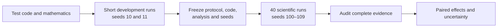

# Learning through the next experiment

The [first-stage specification](first-stage-protocol.md) defines the scientific comparison. This guide explains why its new machinery matters. The [progress log](progress.md) distinguishes implementation checks from the eventual 40-run experiment.

## 1. Freeze the question before seeing the answer

A **protocol freeze** records the exact hypotheses, settings, code, analysis, random seeds, and calibration references. A SHA-256 digest gives this bundle a reproducible identity. The runner records that identity in every experiment and rejects mismatched code or inputs.

This prevents an easy mistake: observing an inconvenient result, making a small adjustment, and presenting the new run as if it belonged to the original comparison. Changes remain possible, but they create a documented new experiment. A local freeze is an audit trail; it is not independent preregistration.

The eight development checks use 16,000 transitions each: 10,000 random-action warmup transitions and 6,000 subsequent interactions. That earns 1,500 twin-critic and 750 actor updates. One learner injection occurs at transition 15,000. These short runs exercise the algorithm and logging; their performance cannot answer the 200,000-step research question.

## 2. Observe without changing learning

The pilot measured critic residuals from the last training minibatch. That was inexpensive, but the sample depended on which replay sampler the learner used. The new diagnostics draw their own bounded samples and use their own random streams.

This separation includes more than a different random seed. Diagnostic draws must not increase training reuse counters. Computing a gradient for inspection must not change network weights, accumulated `.grad` values, or optimizer state. Saving and resuming must restore diagnostic randomness too, or the explanation would change even when the learned policy did not.

The tests compare an entire learned trajectory with diagnostics enabled and disabled. They also compare uninterrupted and resumed diagnostic tables. Equal final scores alone would be a much weaker check: different internal histories can accidentally yield similar scores.

## 3. Ask which experience the learner sees

The **resident distribution** describes everything still in the replay buffer. The **sampled distribution** describes what a sampler draws from it. With global FIFO retention, two arms can have the same storage rule but different exposure to sources and ages.

The new tables contain age/reuse quantiles and fixed age-bin counts. A median gives the middle of a distribution; a 90th percentile shows where its older tail begins. Read `population=resident` as a census of stored records and `population=diagnostic_sample` as a bounded checkpoint estimate from 128 draws. Those sampled-bin counts are not a count of all gradient-training draws.

At 200,000 training transitions, the 100,000-slot buffer has evicted old experience. A resident transition's reuse count records draws while that transition survives. It cannot recover reuse statistics for records already evicted. That is why source totals and resident summaries answer different questions.

## 4. Compare learning signals, not just losses

For a stored transition, TD3 builds a bootstrapped target $y$ and computes critic residuals such as $|Q(s,a)-y|$. Two critics can agree with each other and still be wrong; a small residual only says the prediction resembles its current target.

Under delay 20, most emitted rewards are zero and every twentieth transition emits an accumulated sum. **Reward-block phase** identifies the transition's position within that block. Grouping residuals by phase helps reveal whether the learner struggles at reward-emission steps. A large residual there is not automatically a bug: target magnitudes also change. The pending reward remains hidden from the policy, as declared in the intervention.

The **gradient cosine** compares the local update directions suggested by two source batches. For critic-loss gradients $g_E$ and $g_L$:

$$c=\frac{g_E^\top g_L}{\|g_E\|\,\|g_L\|}.$$

If the vectors point the same way, $c=1$; perpendicular vectors give zero; opposite directions give −1. For example, $(1,0)$ and $(1,1)$ have cosine about 0.707. If either norm is zero, the cosine is undefined. These are illustrative vectors, not measured outcomes.

Alignment might suggest compatible local learning signals, but it does not establish helpful transfer. The gradients depend on a small batch, a particular network state, and bootstrapped targets. The controlled replay comparison provides the performance evidence; this diagnostic helps develop explanations.

## 5. Pair runs before estimating uncertainty

One training seed supplies four runs: two replay methods at two feedback delays. Pairing reuses initialization and reset schedules across those conditions. Trajectories still diverge as learning changes.

For each seed, first subtract pooled AUC from balanced AUC under delay 20. **H1** concerns the mean of those ten within-seed differences. **H2** subtracts the same contrast under delay 1—a difference of differences. H1 asks whether balancing helps with delayed feedback; H2 asks whether its effect depends on feedback delay.

A **paired bootstrap** repeatedly draws ten complete seed records with replacement. Every selected record keeps all four conditions and its entire learning history together. Computing the effect for 10,000 such resamples produces an empirical uncertainty distribution. Its 2.5th and 97.5th percentiles form the prespecified interval.

Reusing the same sampled seed indices across delays is essential. Separately bootstrapping the delays would discard their pairing; treating individual checkpoints or evaluation episodes as independent agents would invent extra evidence. The statistical tests use temporary constructed inputs whose correct answer is known; those examples never enter the scientific results directory.

## 6. Read progress without selecting an outcome

Every planned run has a status: pending, running, completed, failed, or interrupted. A missing run stays visible. The analysis produces a completion report until the entire prespecified comparison passes validation; it does not silently discard missing seeds and calculate an appealing interval from the survivors.

After the study, inspect the point estimate, interval, individual seed contrasts, and practical threshold together. A positive estimate with an interval crossing zero remains inconclusive. An interval entirely above zero supports the predicted direction in this task; its lower endpoint must also exceed 0.05 normalized AUC units to clear the declared practical-effect threshold. None of these outcomes establishes universal superiority of ERL or balanced replay.

**Try before reading an eventual result:** predict how changing the replay mixture affects learner-data reuse, which reward phases might have larger residuals, and why final return and AUC may rank methods differently. Record the predictions in your own notes. Compare them with the full evidence after execution, including outcomes that contradict them.

## 7. Read one measured diagnostic snapshot

Use the first development seed, **10**, with balanced replay and delay 20 as a worked example. At its final 16,000-transition checkpoint, the [replay table](../results/validation/next-stage/first_stage_validation__Pendulum-v1__erl_balanced__d020__s010/diagnostic_replay.csv) and [critic table](../results/validation/next-stage/first_stage_validation__Pendulum-v1__erl_balanced__d020__s010/diagnostic_critic.csv) record:

| Measurement | Population source | Learner source | How to read it |
|---|---:|---:|---|
| Stored transitions | 12,800 | 3,200 | Four population episodes accompany one learner episode. |
| Resident median training reuse | 8 | 33 | Equal source sampling revisits the smaller source more often. |
| Records in the replay diagnostic draw | 64 | 64 | The sampler enforces source balance; storage remains 80:20. |
| Median absolute TD residual, all phases | 5.91 | 6.03 | Each estimate uses 128 independent diagnostic draws. |
| Median absolute TD residual, phase 20 | 124.76 | 117.44 | The reward-emission groups contain only six and four draws. |
| Joint critic-gradient norm | 81.29 | 151.62 | A direction comparison alone hides differences in magnitude. |

The cross-source gradient cosine was **−0.671**. At this network state, these two sampled critic objectives suggested partially opposing local directions. It is one checkpoint measurement with bootstrapped targets, not a causal explanation of performance or a method ranking. The much larger phase-20 residuals also accompany much larger emitted rewards; they do not establish that those values are less accurate against an external ground truth.

The [run journal](../results/validation/next-stage/first_stage_validation__Pendulum-v1__erl_balanced__d020__s010/journal.md) reports native return moving from −1,323.78 to −1,320.82. Seven of the eight short development runs instead ended below their initialization. Keep those outcomes visible: passing an implementation check establishes budget and state-accounting correctness, while answering the research question requires the separate, longer, paired study.
