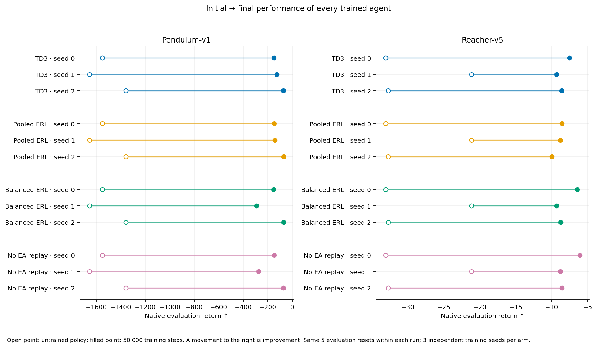
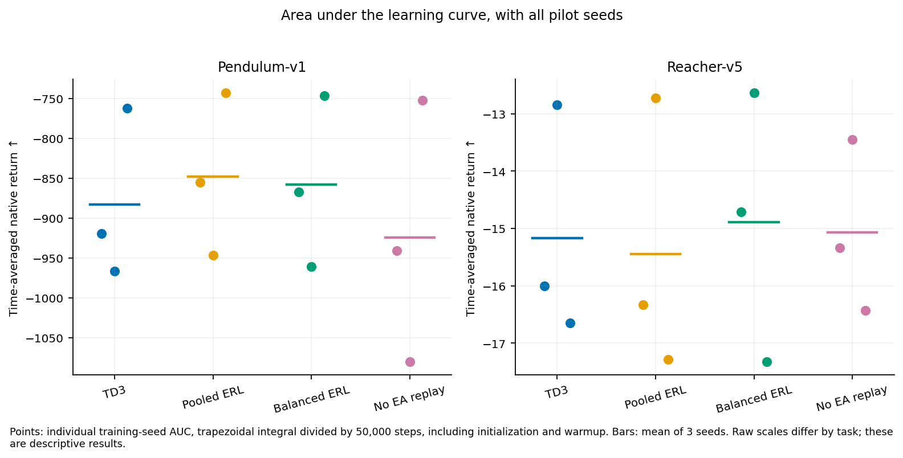
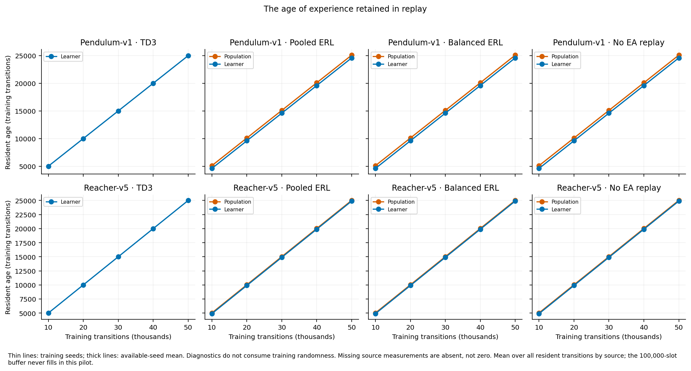
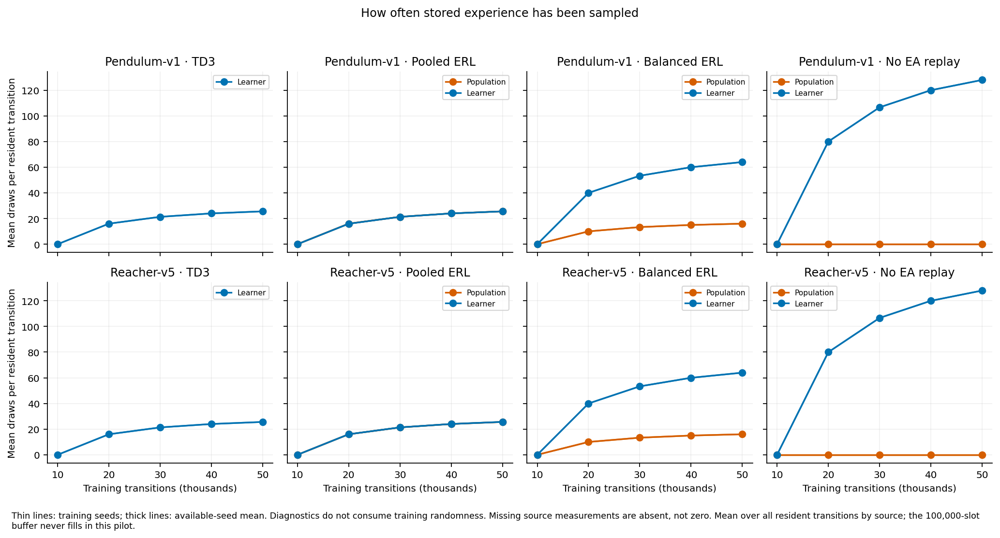
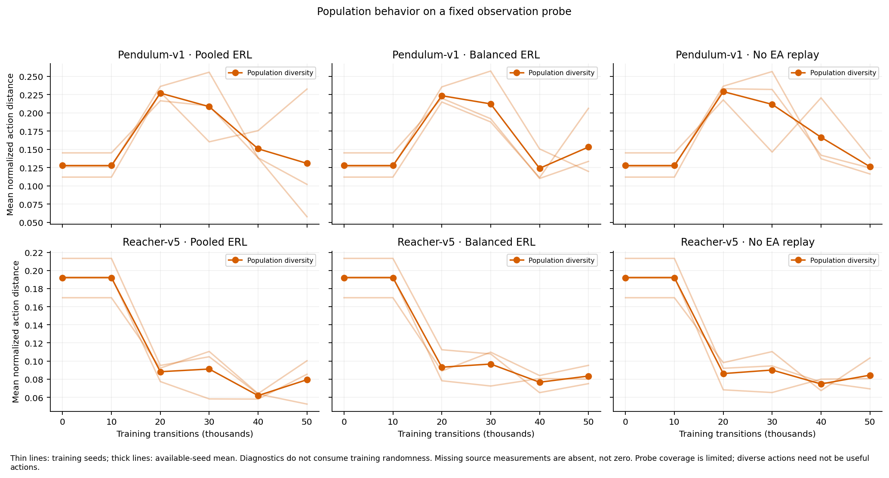
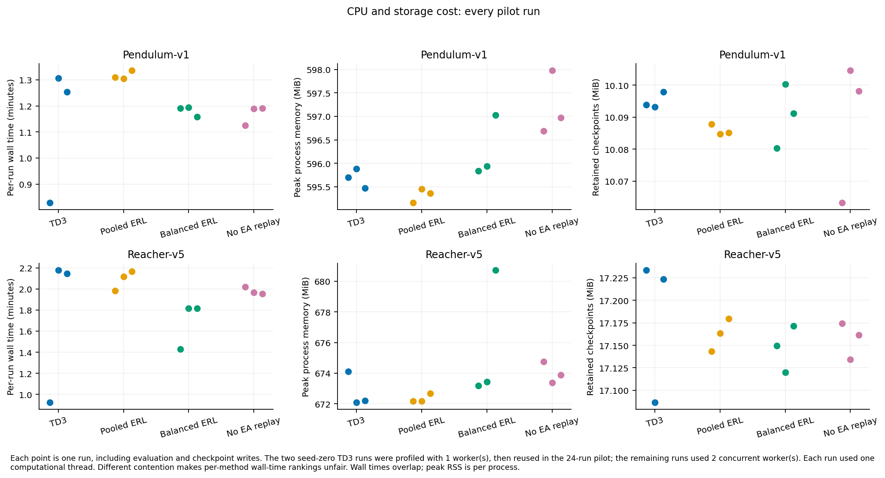
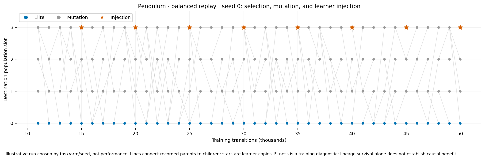

# CPU pilot results

All 24 planned runs completed and passed the analysis budget/grid checks. These are immediate-reward development runs with three training seeds per task/method. They measure correctness, baseline learnability, and CPU cost; **they do not test the delayed-reward hypothesis H1**.

| Task | Method | Final native return, mean ± seed SD | Mean raw AUC | Mean run time |
|---|---|---:|---:|---:|
| Pendulum-v1 | TD3 | -116.29 ± 40.00 | -882.83 | 1.13 min |
| Pendulum-v1 | Pooled ERL | -120.36 ± 42.51 | -848.16 | 1.32 min |
| Pendulum-v1 | Balanced ERL | -171.84 ± 112.49 | -858.17 | 1.18 min |
| Pendulum-v1 | No EA replay | -164.92 ± 101.84 | -924.58 | 1.17 min |
| Reacher-v5 | TD3 | -8.50 ± 0.90 | -15.17 | 1.75 min |
| Reacher-v5 | Pooled ERL | -9.11 ± 0.74 | -15.45 | 2.09 min |
| Reacher-v5 | Balanced ERL | -8.17 ± 1.53 | -14.89 | 1.69 min |
| Reacher-v5 | No EA replay | -7.81 ± 1.50 | -15.07 | 1.98 min |

Raw AUC is the trapezoidal learning-curve integral divided by the 50,000-step budget, so its units are native episode return. Less negative return/AUC is better. Seed SD describes variation among three trained agents; it is not a confidence interval. See [individual runs](run-guide.md) and [machine-readable summaries](summary.json).

Verified totals: **1,200,000 training transitions**, **90,000 evaluation transitions**, **240,000 twin-critic updates**, and **120,000 actor updates**. Every run has 30 evaluation episodes, an unchanged learner across random-action warmup, finite returns, and the intended replay sample count. All runs share the same recorded trainer source hashes and match the calibration artifact hash.

Summed per-run wall time is 36.90 minutes. Concurrent runs overlap, so this is not suite elapsed time. The two profiling runs are included in the 24-run totals. Calibration, smoke checks, installation, and analysis are outside these run totals. One critic update trains both critics.

The two seed-zero TD3 runs were profiled with 1 worker(s), then reused in the 24-run pilot; the remaining runs used 2 concurrent worker(s). Each run used one computational thread. Different contention makes per-method wall-time rankings unfair.

A complete immediate-reward run cannot establish delayed-reward robustness. These small-seed comparisons must not choose whichever arm happens to win as a new hypothesis. Freeze any justified implementation/settings revisions before using the disjoint confirmatory seeds. The 100,000-slot replay buffer is not filled by a 50,000-step pilot, so separate tests must establish eviction correctness.

Thin lines: 3 training seeds; thick line: seed mean. Each checkpoint averages 5 evaluation episodes. Shading: random-action warmup. No smoothing or confidence bands.

[SVG](figures/learning-curves.svg) · [PDF](figures/learning-curves.pdf)

Open point: untrained policy; filled point: 50,000 training steps. A movement to the right is improvement. Same 5 evaluation resets within each run; 3 independent training seeds per arm.

[SVG](figures/initial-final.svg) · [PDF](figures/initial-final.pdf)

Points: individual training-seed AUC, trapezoidal integral divided by 50,000 steps, including initialization and warmup. Bars: mean of 3 seeds. Raw scales differ by task; these are descriptive results.

[SVG](figures/raw-auc.svg) · [PDF](figures/raw-auc.pdf)

Measured final collected/resident shares and cumulative sampled shares. Bars: mean of 3 seeds; black points: seeds (often overlapping). Warmup source tags identify collector slots, not evolved behavior.

[SVG](figures/replay-provenance.svg) · [PDF](figures/replay-provenance.pdf)

Thin lines: training seeds; thick lines: available-seed mean. Diagnostics do not consume training randomness. Missing source measurements are absent, not zero. Mean over all resident transitions by source; the 100,000-slot buffer never fills in this pilot.

[SVG](figures/replay-age.svg) · [PDF](figures/replay-age.pdf)

Thin lines: training seeds; thick lines: available-seed mean. Diagnostics do not consume training randomness. Missing source measurements are absent, not zero. Mean over all resident transitions by source; the 100,000-slot buffer never fills in this pilot.

[SVG](figures/replay-reuse.svg) · [PDF](figures/replay-reuse.pdf)

Thin lines: training seeds; thick lines: available-seed mean. Diagnostics do not consume training randomness. Missing source measurements are absent, not zero. Probe coverage is limited; diverse actions need not be useful actions.

[SVG](figures/population-diversity.svg) · [PDF](figures/population-diversity.pdf)

Each point is one run, including evaluation and checkpoint writes. The two seed-zero TD3 runs were profiled with 1 worker(s), then reused in the 24-run pilot; the remaining runs used 2 concurrent worker(s). Each run used one computational thread. Different contention makes per-method wall-time rankings unfair. Wall times overlap; peak RSS is per process.

[SVG](figures/compute-cost.svg) · [PDF](figures/compute-cost.pdf)

Illustrative run chosen by task/arm/seed, not performance. Lines connect recorded parents to children; stars are learner copies. Fitness is a training diagnostic; lineage survival alone does not establish causal benefit.

[SVG](figures/lineage.svg) · [PDF](figures/lineage.pdf)
